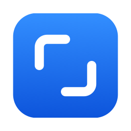

# PeekShot

> A free, open-source alternative to CleanShot X. Capture, annotate and pin screenshots on macOS — straight from the menu bar.

<p align="center">
  
</p>

<p align="center">
  <a href="README.zh-CN.md">中文</a> ·
  <a href="https://github.com/Jason-Kou/PeekShot/releases">Download</a>
</p>

Native Swift + AppKit + ScreenCaptureKit. No account, no telemetry, no network access.

## Features

- **Capture** — area, window, full screen, previous area and self-timer. The screen freezes while you select, with a crosshair, a pixel loupe and a live size readout.
- **Capture Text (OCR)** — select a region and the recognized text lands on your clipboard. Works offline, English and Chinese.
- **Quick Access overlay** — every capture shows up as a card in the corner: copy, save, annotate, pin, or drag it straight into another app.
- **Annotation editor** — arrow, line, rectangle, ellipse, pencil, highlighter, text, counter, pixelate, blur, spotlight and crop, with undo/redo and move/resize.
- **Pin to screen** — keep a screenshot floating above your windows; scroll to zoom, ⌥-scroll to change opacity.
- **History** — browse, re-edit, re-copy or drag out recent captures.
- **Yours to configure** — global shortcuts, save location and format, a `peekshot://` URL scheme for scripts and launchers.

Not included: screen recording, scrolling capture and cloud upload.

## Install

### Download

1. Grab the latest `.dmg` from [Releases](https://github.com/Jason-Kou/PeekShot/releases).
2. Open it and drag **PeekShot** into **Applications**.
3. Launch PeekShot. It lives in the menu bar and has no Dock icon.

**First launch.** PeekShot is not notarized by Apple yet, so macOS blocks it the first time. Open **System Settings → Privacy & Security**, scroll down and click **Open Anyway**. Or remove the quarantine flag yourself:

```bash
xattr -dr com.apple.quarantine /Applications/PeekShot.app
```

**Screen recording permission.** macOS asks for it on first launch. Turn on PeekShot under **System Settings → Privacy & Security → Screen & System Audio Recording**, then relaunch the app.

**Requirements:** macOS 14.0 or later, Apple Silicon or Intel.

### Build from source

Requires Xcode and [XcodeGen](https://github.com/yonaskolb/XcodeGen) (`brew install xcodegen`).

```bash
git clone https://github.com/Jason-Kou/PeekShot.git
cd PeekShot
scripts/setup-signing.sh   # once per machine, see "Signing" below
scripts/build.sh           # builds dist/PeekShot.app
open dist/PeekShot.app
```

## Usage

### Shortcuts

All of these can be changed in **Settings → Shortcuts**.

| Action | Default |
| --- | --- |
| Capture Area | ⌃⌥A |
| Capture Window | ⌃⌥W |
| Capture Fullscreen | ⌃⌥F |
| Capture Previous Area | ⌃⌥R |
| Self-Timer | ⌃⌥T |
| Capture Text (OCR) | ⌃⌥O |
| Capture History | ⌃⌥H |

**While selecting:** Space switches between area and window mode, hold Space while dragging to move the selection, ⇧ for a square, ⌥ to resize from the center, Esc or right-click to cancel.

**In the editor:** V select, C crop, A arrow, L line, R rectangle, O ellipse, P pencil, H highlighter, T text, N counter, X pixelate, B blur, S spotlight. ⌘Z / ⇧⌘Z undo and redo, ⌘C copy and close, ⌘S save, ⇧⌘S save as, ⌘0 zoom to fit.

### Can't see the menu bar icon?

On a MacBook with a notch, a crowded menu bar can hide the icon. Open PeekShot again (double-click it, or `open -a PeekShot`) and the settings window appears, with buttons for the capture history and for quitting.

### URL scheme

```bash
open peekshot://capture-area
```

Available actions: `capture-area`, `capture-window`, `capture-fullscreen`, `capture-previous-area`, `capture-timer`, `capture-text`, `history`, `settings`, `about`.

## Development

### Tests

```bash
xcodegen generate
xcodebuild -project PeekShot.xcodeproj -scheme PeekShot -derivedDataPath build test
```

The interaction tests briefly show the selection overlay and editor windows on screen. Set `TEST_RUNNER_PEEKSHOT_SNAPSHOT_DIR=<dir>` to also render each screen to a PNG for a visual check.

### Signing

macOS ties the screen recording grant to the app's code signature. `scripts/build.sh` signs with a local self-signed certificate named "PeekShot Local Signing", so the grant survives rebuilds. Run `scripts/setup-signing.sh` once per machine to create it; the first build afterwards asks for keychain access — enter your login password and choose **Always Allow**. Without the certificate the script falls back to ad-hoc signing, and macOS asks for the permission again after every rebuild.

Keep a single Release copy on disk (`dist/`). The Debug build, which doubles as the unit test host, uses its own bundle id `app.peekshot.PeekShot.debug`. Otherwise macOS may relaunch an unsigned copy with the same bundle id, which shows up as "permission granted but still asked again".

### Releasing

```bash
scripts/make-dmg.sh        # builds dist/PeekShot-v<version>-mac-universal.dmg and dist/SHA256SUMS
```

The script signs with a "Developer ID Application" certificate and notarizes when both that certificate and a `notarytool` keychain profile named `peekshot` exist. Otherwise it ships the locally signed build and says so.

### Layout

- `Sources/PeekShot/App` — entry point, menu bar, preferences, global shortcuts
- `Sources/PeekShot/Capture` — ScreenCaptureKit capture, selection overlay, capture flows, text recognition
- `Sources/PeekShot/Output` — encoding and saving, clipboard, history store
- `Sources/PeekShot/QuickAccess` — the overlay card shown after a capture
- `Sources/PeekShot/Editor` — annotation model, renderer, canvas, editor window
- `Sources/PeekShot/Pin`, `History`, `Settings` — pinned images, history window, settings and About
- `scripts/` — build, signing setup, DMG packaging, icon generation

## License

[MIT](LICENSE). Free and open source.

PeekShot is an independent project. It is not affiliated with or endorsed by the makers of CleanShot X.
