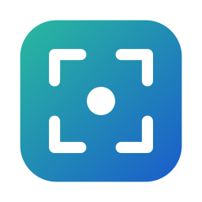

# PeekShot

> CleanShot X 的免费、开源替代品。在 macOS 上截图、标注、贴图，全在菜单栏里完成。

<p align="center">
  
</p>

<p align="center">
  <a href="README.md">English</a> ·
  <a href="https://github.com/Jason-Kou/PeekShot/releases">下载</a>
</p>

原生 Swift + AppKit + ScreenCaptureKit。不需要账号，不收集数据，不联网。

## 功能

- **截图**：区域、窗口、全屏、上次区域、延时截图。选区时屏幕定格，带十字线、像素放大镜和实时尺寸。
- **滚动长截图**：框选一块区域，在里面往下滚动（或者点自动滚动），得到整页的一张长图。吸顶的标题栏和底栏只保留一份，旁边实时预览拼接结果。
- **识别文字（OCR）**：框选一块区域，识别出的文字直接进剪贴板。离线可用，支持中英文。
- **悬浮预览**：每次截图后在屏幕角落出现一张卡片，可复制、保存、标注、贴图，或直接拖进其他应用。
- **标注编辑器**：箭头、直线、矩形、椭圆、画笔、高亮、文字、序号、马赛克、模糊、聚焦、裁剪，支持撤销重做和移动缩放。
- **贴图**：把截图悬浮在所有窗口之上；滚轮缩放，⌥ 加滚轮调透明度。
- **历史**：浏览最近的截图，可重新标注、复制或拖出。
- **可配置**：全局快捷键、保存位置和格式，以及给脚本和启动器用的 `peekshot://` URL。

## PeekShot 与 CleanShot X 对比

PeekShot 覆盖了 CleanShot X 日常截图的那部分流程，免费，并且源码公开。它不打算替代全部功能。

| | PeekShot | CleanShot X |
| --- | --- | --- |
| 价格 | 免费 | 付费 |
| 源码 | 开源（MIT） | 闭源 |
| 区域、窗口、全屏截图 | 有 | 有 |
| 悬浮预览 | 有 | 有 |
| 标注编辑器 | 有 | 有 |
| 文字识别（OCR） | 有 | 有 |
| 贴图到屏幕 | 有 | 有 |
| 滚动长截图 | 有 | 有 |
| 录屏和 GIF | 无 | 有 |
| 背景工具 | 无 | 有 |
| 云上传 | 无 | 有 |

如果你只是想截一块屏幕、标注一下再贴到别处，PeekShot 就是一个免费的 CleanShot 替代品。

## 安装

### 下载

1. 从 [Releases](https://github.com/Jason-Kou/PeekShot/releases) 下载最新的 `.dmg`。
2. 打开后把 **PeekShot** 拖进 **Applications**。
3. 启动 PeekShot。它只在菜单栏显示图标，没有 Dock 图标。

**首次启动。** PeekShot 目前还没有经过 Apple 公证，第一次打开会被 macOS 拦住。到 **系统设置 → 隐私与安全性**，往下滚动，点 **仍要打开**。也可以自己去掉隔离标记：

```bash
xattr -dr com.apple.quarantine /Applications/PeekShot.app
```

**录屏权限。** 首次启动时 macOS 会请求。在 **系统设置 → 隐私与安全性 → 录屏与系统录音** 里打开 PeekShot，然后重新启动应用。

**系统要求：** macOS 14.0 及以上，Apple 芯片或 Intel 均可。

### 从源码构建

需要 Xcode 和 [XcodeGen](https://github.com/yonaskolb/XcodeGen)（`brew install xcodegen`）。

```bash
git clone https://github.com/Jason-Kou/PeekShot.git
cd PeekShot
scripts/setup-signing.sh   # 每台机器一次，见下面的“签名”
scripts/build.sh           # 生成 dist/PeekShot.app
open dist/PeekShot.app
```

## 使用

### 快捷键

都可以在 **Settings → Shortcuts** 里修改。

| 功能 | 默认 |
| --- | --- |
| 截取区域 | ⌃⌥A |
| 截取窗口 | ⌃⌥W |
| 截取全屏 | ⌃⌥F |
| 截取上次区域 | ⌃⌥R |
| 延时截图 | ⌃⌥T |
| 滚动长截图 | ⌃⌥S |
| 识别文字（OCR） | ⌃⌥O |
| 截图历史 | ⌃⌥H |

**选区中：** 空格切换区域 / 窗口模式，拖动时按住空格移动选区，⇧ 正方形，⌥ 从中心拉伸，Esc 或右键取消。

**滚动长截图中：** 在框内慢慢往下滚动，或者点 Auto-Scroll 自动滚动。回车或 Done 完成，Esc 或 Cancel 放弃。自动滚动需要在 **系统设置 → 隐私与安全性 → 辅助功能** 里允许 PeekShot，手动滚动不需要。

**编辑器中：** V 选择、C 裁剪、A 箭头、L 直线、R 矩形、O 椭圆、P 画笔、H 高亮、T 文字、N 序号、X 马赛克、B 模糊、S 聚焦。⌘Z / ⇧⌘Z 撤销重做，⌘C 复制并关闭，⌘S 保存，⇧⌘S 另存为，⌘0 适应窗口。

### 看不到菜单栏图标？

带刘海的 MacBook 上，菜单栏图标太多时它会被挡住。再打开一次 PeekShot（双击应用，或 `open -a PeekShot`）就会弹出设置窗口，里面有打开截图历史和退出的按钮。

### URL 触发

```bash
open peekshot://capture-area
```

可用的动作：`capture-area`、`capture-window`、`capture-fullscreen`、`capture-previous-area`、`capture-timer`、`capture-scrolling`、`capture-text`、`history`、`settings`、`about`。

## 开发

### 测试

```bash
xcodegen generate
xcodebuild -project PeekShot.xcodeproj -scheme PeekShot -derivedDataPath build test
```

交互测试会在屏幕上短暂弹出选区遮罩和编辑器窗口。设置 `TEST_RUNNER_PEEKSHOT_SNAPSHOT_DIR=<目录>` 可以把各界面渲染成 PNG 供肉眼检查。

### 签名

macOS 把录屏授权绑定在应用的代码签名上。`scripts/build.sh` 用本机自签名证书 “PeekShot Local Signing” 签名，这样重新构建后授权仍然有效。每台机器先运行一次 `scripts/setup-signing.sh` 创建证书；之后第一次构建会弹出钥匙串授权框，输入登录密码并选 **始终允许**。没有这张证书时脚本会退回 ad-hoc 签名，此时每次重新构建后 macOS 都会要求重新授权。

磁盘上只保留 `dist/` 里这一份正式版。Debug 构建（同时是测试宿主）使用单独的应用标识 `app.peekshot.PeekShot.debug`。否则 macOS 可能重新启动另一份同标识但没有授权的副本，表现为“授权后仍然提示没有权限”。

### 发布

```bash
scripts/make-dmg.sh        # 生成 dist/PeekShot-v<版本>-mac-universal.dmg 和 dist/SHA256SUMS
```

如果钥匙串里有 “Developer ID Application” 证书和名为 `peekshot` 的 `notarytool` 凭据，脚本会用它签名并公证；否则打包本机签名的版本，并给出提示。

### 代码结构

- `Sources/PeekShot/App`：入口、菜单栏、偏好设置、全局快捷键
- `Sources/PeekShot/Capture`：ScreenCaptureKit 截屏、选区遮罩、截图流程、文字识别
- `Sources/PeekShot/Output`：编码与保存、剪贴板、历史存储
- `Sources/PeekShot/QuickAccess`：截图后的悬浮预览卡片
- `Sources/PeekShot/Editor`：标注模型、渲染、画布、编辑器窗口
- `Sources/PeekShot/Pin`、`History`、`Settings`：贴图、历史窗口、设置和 About
- `scripts/`：构建、签名证书、DMG 打包、图标生成

## 许可证

[MIT](LICENSE)。免费、开源。

PeekShot 是独立项目，与 CleanShot X 的开发者没有关联，也未获其认可。
